# Labs64.IO :: Checkout

**A whitelabel checkout that looks like you: from order to transaction.**
*Part of the [Labs64.IO Ecosystem](https://labs64.io): the order and checkout layer in front of your payments.*

[](https://github.com/Labs64/labs64.io-checkout/actions/workflows/labs64io-be-ci.yml)
[](https://github.com/Labs64/labs64.io-checkout/actions/workflows/labs64io-fe-ci.yml)
[](https://hub.docker.com/r/labs64/checkout)
[&logo=docker&logoColor=white&color=1C90ED)](https://hub.docker.com/r/labs64/checkout-ui)
[](https://artifacthub.io/packages/helm/labs64io-helm-charts/checkout)
[](LICENSE)
[](https://labs64.io/docs/modules/checkout/)

<p align="center"></p>

[Why Checkout?](#why-checkout) · [Documentation](https://labs64.io/docs/modules/checkout/) · [Build and test](#build-and-test) · [Ecosystem](#the-labs64io-ecosystem) · [labs64.io](https://labs64.io)

> [!NOTE]
> Checkout currently records the buyer's checkout transaction as `PENDING` and returns `nextAction: NONE`. Handing the transaction to the Payment Gateway is not connected yet.

## Why Checkout?

A checkout is more than a payment form. It has to hold the order, the buyer, the tax and currency rules and the consents, and it has to look like your brand rather than someone else's. Checkout gives you that as an API plus a page you can theme.

1. **One order model.** A purchase order carries items, currency, tax, an optional customer and a validity window.
2. **Rules enforced for you.** Currency, tax rate, time range, extras and required consents are validated before a transaction exists.
3. **A checkout page that is yours.** A Vue 3 page with i18n and runtime configuration, served from a small static image.

**A good fit if**

- You sell digital or physical goods and want an order and checkout service you can brand and host yourself.
- Consents (terms, marketing, data processing) must be captured per order and enforced before checkout.
- You are building on the Labs64.IO platform and want orders, payments and audit to fit together.

**Probably not what you need if**

- You need payments executed end to end today: Checkout currently records the transaction and does not yet hand it to the Payment Gateway.
- You want a complete shop (catalogue, cart, inventory): Checkout starts at the purchase order.

## Documentation

Install, configure and operate Checkout in the **[Checkout documentation](https://labs64.io/docs/modules/checkout/)**.

[Quick Start](https://labs64.io/docs/modules/checkout/#quick-start) · [Configuration](https://labs64.io/docs/modules/checkout/#configuration) · [REST APIs](https://labs64.io/docs/modules/checkout/#rest-apis)

New to Labs64.IO? The [Quickstart](https://labs64.io/docs/getting-started/quickstart.html) puts the platform on any Kubernetes cluster in about five minutes.

## Build and test

```bash
cd checkout-be
just test        # mvn clean verify
just dev-up      # build and start the API with PostgreSQL and Cerbos (:8080)

cd ../checkout-fe
just build       # npm install + npm run build
just dev-up      # the checkout page (:5173)
```

Needs JDK 25, Maven 3.6.3+, Node and Docker. Working on the code with an AI agent? [`AGENTS.md`](AGENTS.md) and [`CLAUDE.md`](CLAUDE.md) describe the layout, conventions and checks.

## The Labs64.IO Ecosystem

This repository is part of the [Labs64.IO Ecosystem](https://labs64.io): open-source building blocks for secure commerce platforms. Every module is documented at [labs64.io/docs](https://labs64.io/docs/).

| Module | What it does |
|---|---|
| [**AuditFlow**](https://github.com/Labs64/labs64.io-auditflow) | Publish once, route anywhere, lose nothing |
| [**Auth Gateway**](https://github.com/Labs64/labs64.io-authproxy) | One authenticated edge for every module |
| [**Payment Gateway**](https://github.com/Labs64/labs64.io-payment-gateway) | One API across multiple payment providers |
| [**Checkout**](https://github.com/Labs64/labs64.io-checkout) | Whitelabel checkout and order workflow |
| [**Customer Portal**](https://github.com/Labs64/labs64.io-customer-portal) | Self-service portal for your customers |

Built on [Commons](https://github.com/Labs64/labs64.io-commons), deployed with [Helm Charts](https://github.com/Labs64/labs64.io-helm-charts), developed in the [Workspace](https://github.com/Labs64/labs64.io-workspace), verified by [Tests](https://github.com/Labs64/labs64.io-tests) and documented in [Docs](https://github.com/Labs64/labs64.io-docs). Also from Labs64: [NetLicensing](https://netlicensing.io) for licensing-as-a-service and [GuideChimp](https://www.labs64.com/guidechimp/) for guided product tours.

## Contributing

We would love your help. Connecting Checkout to the Payment Gateway, publishing events to AuditFlow and finishing the checkout page are the biggest open areas. Fork the repository, make your change on a branch, run the checks described in [`AGENTS.md`](AGENTS.md) and open a pull request. Not sure whether an idea fits? Open an issue first.

## License

Open source under the [Apache License 2.0](LICENSE): use it, change it and ship it commercially.

---

<p align="center">
  <a href="https://labs64.io"></a><br>
  <sub>Made by the <a href="https://labs64.io">Labs64</a> team and community.</sub>
</p>
