# Labs64.IO :: Checkout

**A whitelabel checkout that looks like you: from order to transaction.** Checkout is the order and checkout layer in front of your payments: it holds a purchase order with its items, currency, tax, an optional customer and a validity window, validates currency, tax rate, time range, extras and required consents, and records the checkout transaction, through a REST API and a themable Vue 3 checkout page. It does not yet hand the transaction to the Payment Gateway: it records it as `PENDING`.

[&logo=github)](https://github.com/Labs64/labs64.io-checkout/actions/workflows/labs64io-be-ci.yml)
[&logo=github)](https://github.com/Labs64/labs64.io-checkout/actions/workflows/labs64io-fe-ci.yml)

[&logo=docker&logoColor=white&color=1C90ED)](https://hub.docker.com/r/labs64/checkout-ui)

## The Labs64.IO Ecosystem

Checkout is one module of the [Labs64.IO Ecosystem](https://labs64.io). Its documentation is at [labs64.io/docs/modules/checkout](https://labs64.io/docs/modules/checkout/); [all modules are listed in the documentation](https://labs64.io/docs/services/).

---

   
  Made by the <a href="https://labs64.io">Labs64</a> team and community.

